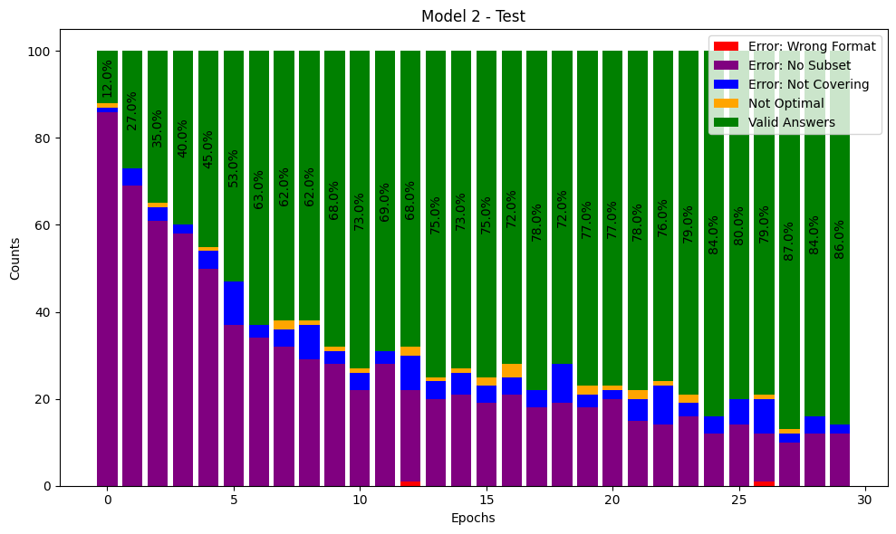

# SetCoverTransformer – Learning to solve Set Cover with a Transformer

Master's thesis project, MSc Computer Science – Artificial Intelligence, University of Padova (2024).

Can a sequence-to-sequence Transformer learn to solve a combinatorial optimisation problem from examples alone? This project adapts the architecture of
[*Deep Learning for Symbolic Mathematics*](https://arxiv.org/abs/1912.01412) (Lample & Charton, ICLR 2020), originally built to integrate functions symbolically, to the **Set Cover problem**: given a universe of elements and a family of subsets, pick the smallest number of subsets whose union covers the universe.

## Approach

1. **Data generation** (`DeepSetCover/src/`): random Set Cover instances are generated as binary matrices (subsets × elements), guaranteeing that every element appears in at least one subset. Each instance is labelled with an **optimal** solution found by brute force, and cross-checked against the [SetCoverPy](https://github.com/guangtunbenzhu/SetCoverPy) solver.
2. **Tokenisation**: instances and solutions are serialised as token sequences (problem → list of chosen subsets), so the task becomes sequence-to-sequence translation.
3. **Model** (`SymbolicMathematics/src/`): encoder–decoder Transformer (default 4 + 4 layers, 4 heads, 256-dim embeddings) trained in PyTorch, with greedy and beam-search decoding.
4. **Evaluation** (`SymbolicMathematics/src/evaluator.py`, `src/envs/set_cover_utils.py`): exact-match accuracy is not enough, because many instances have several optimal covers. Every predicted solution is therefore **checked against the problem itself** and classified as:

   | Outcome | Meaning |
   |---|---|
   | Wrong format | the output cannot be parsed into subsets |
   | Subset not in problem | the model invented a subset that does not exist |
   | Not covering | the chosen subsets leave elements uncovered (coverage % is tracked) |
   | Not optimal | a valid cover, but larger than the optimum |
   | **Valid** | a cover with the optimal number of subsets |

   These counts are logged per epoch for validation and test sets, which shows *how* the model fails, not only how often.

## Results

Two trained configurations, 30 epochs each (plots in `SymbolicMathematics/result-report/`):

| Model | Best validation accuracy | Best test accuracy |
|---|---|---|
| Model 1 | ~93% (epoch 28) | ~93% (epoch 20) |
| Model 2 | ~80% (epoch 26) | ~87% valid answers (epoch 27) |



During training the dominant error shifts from *inventing non-existent subsets* (≈ 86% of outputs at epoch 0) to a small residue of *not covering* and *not optimal* answers, while *wrong format* errors almost disappear. Additional notebooks probe beam search (`Cover_beam_integration.ipynb`, `test_beam_performance.ipynb`) and generalisation to longer sequences than seen in training (`longer_sequence_check.ipynb`, `trained_models_generalizations.ipynb`).

## Repository layout

```
DeepSetCover/
  src/data_new_Sanda.py      # instance generator + brute-force optimal labels
  src/subsets_experiments.ipynb  # dataset construction, SetCoverPy comparison
SymbolicMathematics/         # Transformer, trainer, evaluator (adapted from facebookresearch/SymbolicMathematics)
  src/envs/set_cover_utils.py    # token <-> subset conversion, solution validation
  src/evaluator.py               # per-epoch error taxonomy and coverage metrics
  result-report/                 # accuracy / loss / error-breakdown plots
  Reports_Integration.ipynb      # produces the plots
  Model2/                        # trained checkpoint
requirements.txt
```

## Running

Python 3.8 and the pinned versions in `requirements.txt` (PyTorch 2.1, SymPy 1.12, SetCoverPy 0.9).

```bash
pip install -r requirements.txt
cd SymbolicMathematics
python main.py --help
```

The notebooks reproduce the dataset, the evaluation plots and the decoding experiments.

## Credits and licence

The Transformer, trainer and environment code are adapted from
[facebookresearch/SymbolicMathematics](https://github.com/facebookresearch/SymbolicMathematics)
(© Facebook, Inc.), licensed under **CC BY-NC 4.0** – see `SymbolicMathematics/LICENSE`. The Set Cover data generation, tokenisation, solution validation, error taxonomy and experiments are my own work. This repository is shared for academic and portfolio purposes under the same non-commercial licence.
